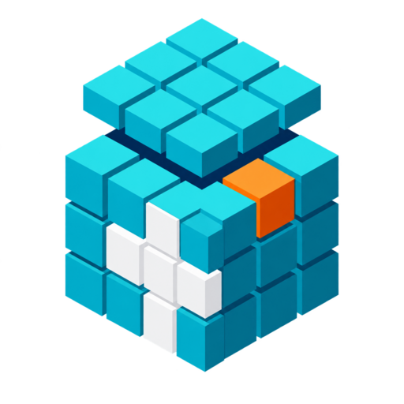

# Dental DICOMator

<p align="center">
  
</p>

Dental DICOMator is a Blender extension that converts selected 3D meshes into
synthetic CT DICOM image series for dental education and medical-physics
research. It is a dental adaptation of DICOMATOR, developed by Michael
Douglass. The dental adaptation was developed by Mateus Bertolini.

> [!WARNING]
> Dental DICOMator produces synthetic research, education, and visualization
> data. It is not a medical device, is not validated for clinical diagnosis or
> treatment, and must not be used as patient-acquired data. Generated SOP
> instances are marked `SyntheticData = YES`.

## Version 1.0.8 highlights

- Titanium now has a fixed highest overlap tier, ensuring implants and metal
  restorations remain visible when they intersect bone or other dental meshes.

CBCT voxel spacing is set to **0.25 x 0.25 x 0.5 mm**. For a field around 132 x 103 x 92 mm, this produces roughly 530 x 414 pixels per image and approximately 186 axial slices, plus the export margin. Each uncompressed 16-bit DICOM slice remains approximately 440 KB.

Blender 5.2 compatibility fixes prevent the sidebar from modifying Scene data while its UI is drawn and restore the partial-volume helper import used during voxelization. Dental objects measured directly in millimetres, including full-arch volumes around 132 x 103 x 92 mm, export on the expected 1 mm grid.

Dental layer depths are now expressed as physical millimetres after the scene-scale correction. The default depths are enamel **1 mm**, PDL **0.25 mm** (painted areas **0.5 mm**), caries **2 mm**, restorative material **1 mm**, and gutta-percha **3 mm**. Thin layers use partial-volume sampling on the fixed 1 mm export grid so that sub-millimetre anatomy is represented without changing slice spacing.

- Dental-only CT workflow with a simplified, numbered sidebar.
- Managed weight-paint workflows for enamel, PDL, caries, restoration, and
  gutta-percha.
- Stable, closed-volume bone voxelization at a fixed educational HU value.
- Fixed dental material presets and automatic layer precedence.
- Optional Gaussian, quantum, motion, and titanium-only metal artifacts.
- DICOM export, metadata, progress, cancellation, validation, and safe staging
  retained from DICOMATOR.

## Requirements

- Blender 5.1 or newer (Python 3.13 runtime).
- NumPy, bundled with Blender.
- pydicom 3.0.2, bundled with this extension as an unmodified PyPI wheel.

The extension has no OpenVDB dependency. Voxelization uses Blender mesh
evaluation, `mathutils.bvhtree.BVHTree`, and NumPy.

## Installation

1. Open **Edit > Preferences > Extensions** in Blender.
2. Open the Extensions menu and choose **Install from Disk...**.
3. Select `Dental-DICOMator-1.0.8-Blender-Extension.zip`.
4. Enable **Dental DICOMator** if Blender does not enable it automatically.

The extension can subsequently be removed from its Preferences entry using
**Uninstall Dental DICOMator**.

## Dental workflow

1. Import the dental STL or other mesh and confirm that it is closed,
   manifold, and correctly scaled.
2. Select the mesh in Blender and open **Sidebar > Dental DICOMator**.
3. In **1. Select Objects and Set Materials**, choose the appropriate dental
   material for each selected object.
4. Enable and paint optional layers. The extension creates, activates, and
   removes the managed vertex groups; users do not need to enter group names.
5. Enter the desired information in **2. Patient Information**.
6. In **3. Export DICOM**, choose a new or empty output directory, review the
   estimate, optionally enable artifacts, and click **Export DICOM**.

The DICOM type is fixed internally to CT Image. Material HU values, group
names, weight thresholds, overlap priority, and advanced artifact parameters
are managed by the extension and hidden from the dental sidebar. The original
deterministic overlap-priority mechanism remains active internally.

## Material behavior

### Bone

**Bone** retains the original stable, closed-volume occupancy mask and uses
**350 HU** cancellous behavior by default. Enabling **Paint Cortical Bone**
automatically creates a managed Cortical vertex group. Only painted surface
regions generate the **800 HU** cortical layer; unpainted surfaces and the
remaining interior stay cancellous. Cortical depth defaults to **2.0 mm**,
Depth Transition to **0.5 mm**, and Weight Blend to **0.2**.

The sidebar provides aligned **Weight Paint** and **Object Mode** buttons. If
cortical painting is disabled, the managed group is removed or disregarded and
the bone is uniformly cancellous. If enabled without usable weights, export
warns the user and safely falls back to cancellous bone.

The cortical calculation changes voxel values only. It does not create shell
geometry, apply a modifier or Boolean operation, erode the volume, or replace
the ray-pair fill. Internal mesh structures receive cortical behavior only when
their corresponding surface vertices are intentionally painted.

### Tooth / Teeth

A tooth is filled with dentin at **1400 HU**. Optional surface layers come from
independent vertex groups managed by the extension:

- **Paint Enamel** is enabled by default. Painted surfaces generate enamel at
  **2000 HU**. Enamel depth defaults to **1 mm** and Weight Blend to **0.2**.
  Disabling it removes/disregards `Enamel` and leaves dentin in those regions.
- **Paint Periodontal Ligament** is disabled by default. When enabled, eligible
  non-enamel external surfaces receive PDL at **-100 HU** with a base depth of
  **0.25 mm**. Painting `PDL` doubles the local layer depth to **0.5 mm**.
- **Paint Caries / Decay** is disabled by default. Painted lesions propagate
  inward at **500 HU**, overriding enamel and dentin. Depth defaults to
  **2 mm**, is limited to **1-4.5 mm**, and Weight Blend defaults to **0.5**.
- **Paint Restorative Material** is disabled by default. Painted areas generate
  restoration at **3000 HU**, with **1 mm** default depth and **0.2** Weight
  Blend. Restoration is the final tooth-layer override.

For an enabled layer, use **Weight Paint** to enter the correct Blender mode
and **Object Mode** to return. White/high weights give the strongest response;
black/unpainted regions do not receive that painted layer. Intermediate weights
and Weight Blend soften the transition.

### Dental Pulp / Gutta-percha

Use a separate pulp-space mesh and assign **Dental Pulp / Gutta-percha**. The
base pulp value is **40 HU**. **Paint Gutta-percha** is enabled by default;
painted `GuttaPercha` regions become radiopaque at **4000 HU** with a managed **3 mm** depth. Its
threshold, and blend are managed internally. Disabling the checkbox removes or
disregards the group and leaves the mesh as pulp.

Pulp/gutta-percha can replace unmodified dentin but does not overwrite enamel,
caries, or restorative material. Correct geometry and spatial overlap remain
the user's responsibility.

### Other dental presets

| Preset | CT value | Intended use |
| --- | ---: | --- |
| Air / Background | -1000 HU | Air or background volume |
| Radiolucent | -500 HU | Low-attenuation teaching object |
| Bone | 800 HU | Uniform closed jaw/bone volume |
| Titanium | 3000 HU | Implant or metallic restoration |
| Zirconia | 3071 HU | Radiopaque ceramic restoration |

The radiolucent preset exposes a **Smooth Margins** option. Disabled produces
a defined boundary; enabled blends the outer margin into background. HU values
are educational presets and are intentionally hidden from the sidebar.

## Layer priority and overlap

Within a tooth, the effective order is:

1. Dentin base
2. PDL on eligible non-enamel surfaces
3. Enamel
4. Caries
5. Restorative material

Pulp/gutta-percha normally comes from a separate overlapping object and is
restricted to replacing unmodified dentin. Between separate objects, the
original deterministic overlap logic remains active but hidden.

## Optional artifacts

Only four artifact checkboxes are exposed:

- **Gaussian Noise**: fixed standard deviation of **20 HU**.
- **Quantum Noise**: fixed photon scale of **250**.
- **Motion**: fixed severity of **5% (0.05)** and blur length of **7**.
- **Titanium Metal Artifacts**: optional streak simulation sourced only from
  voxels assigned the **Titanium** preset.

Titanium artifacts are never enabled automatically. Zirconia, enamel,
gutta-percha, and painted restorative material do not initiate metal streaks.
Older hidden artifact options are ignored by the dental export workflow.

## DICOM output

- CT Image Storage, signed 16-bit values, and air background at -1000 HU.
- `ImageType` identifies the data as derived; `SyntheticData = YES` and
  `SpecificCharacterSet = ISO_IR 192` are written to every slice.
- `PixelSpacing` and slice spacing follow the selected lateral and axial voxel
  size; the padded world-space bounding box defines patient-space positions.
- Selected objects share Study Instance and Frame of Reference UIDs.
- Exports are staged and committed only after all requested slices succeed.
  Cancellation or failure removes the partial staging directory.
- Blender-relative output paths beginning with `//` are supported.
- Export runs as a modal job with progress feedback; press **Esc** to cancel.

## Automatic groups, validation, and fallbacks

- Enabling enamel, PDL, caries, restoration, or gutta-percha creates and
  activates its managed vertex group. Disabling a layer removes its group and
  disregards it during export.
- Before voxelization, missing groups required by enabled options are repaired.
  This supports older `.blend` files without accessing scene objects during
  extension installation.
- An enabled but empty group produces no painted layer. Missing usable enamel
  paint safely falls back to dentin.
- Bone follows the stable uniform closed-volume path.
- Generated CT values are clipped to **-1024..4095 HU**.
- The exporter warns about non-manifold geometry, ambiguous ray intersections,
  missing paint data, and grids that may exceed safe memory limits.

## Scale, geometry, and STL limitations

Dental DICOMator 1.0.8 uses metric Scene Unit Scale `0.001`, so one Blender
world unit represents one millimetre. Export configures this scale
automatically. The fixed dental voxel spacing is 0.25 mm in X/Y and 0.5 mm in Z, which
provides CBCT-like in-plane detail while producing two axial DICOM images per millimetre. `PixelSpacing`,
`SliceThickness`, `SpacingBetweenSlices`, and `ImagePositionPatient` use the
same millimetre coordinate system. World axes map to patient coordinates as
`+X` left, `+Y` posterior, and `+Z` superior.

An STL is only a triangle boundary surface. It contains no internal tissue
labels for enamel, dentin, PDL, pulp, cortical/cancellous bone, caries, or
restoration. Painted tooth layers are therefore approximated using the 3D
distance between filled voxel centers and painted surface polygons.

Accuracy depends on mesh density, weight-paint resolution, voxel size, surface
quality, and object scale. A layer thinner than the voxel spacing may be poorly
represented or invisible. Verify physical dimensions before export.

STL does not preserve vertex groups or weight paint. Save the `.blend` file to
retain dental-layer definitions. For publication-grade quantitative phantoms,
inspect exported masks and HU distributions and consider separately segmented,
nested meshes when true internal boundaries are required.

## Performance limits

Exports are guarded by a 2,000-voxel per-dimension limit, a 100,000,000 total
voxel limit, and a conservative 2 GiB estimated peak array-memory limit. The
advanced oversized-grid override can bypass these limits at the user's risk.
Increasing voxel spacing or reducing selected geometry lowers memory and time.

## Troubleshooting

- **Solid object has holes:** inspect for non-manifold edges, self-intersections,
  duplicate/internal faces, flipped normals, or open boundaries. Repair the
  mesh before export.
- **Paint has no effect:** confirm the layer checkbox is enabled, use its own
  **Weight Paint** button, paint non-zero weights, and save the `.blend` file.
- **Layer appears too thin:** check object scale and use voxel spacing smaller
  than the requested layer depth.
- **Install reports `_RestrictData` has no attribute `objects`:** remove an
  older manually installed copy, restart Blender, and install the packaged
  extension. Current registration does not inspect scene objects at startup.
- **No Uninstall button:** open the extension's entry in Preferences and use
  **Uninstall Dental DICOMator**.

## Development and packaging

Validate and build from the repository root with Blender:

```bash
blender --command extension validate
blender --command extension build --output-filepath Dental-DICOMator-1.0.8-Blender-Extension.zip
```

Automated tests are in `tests/`. The bundled pydicom wheel can be refreshed
with `download_wheels.py` when its pinned version is intentionally updated.

## Preset limitation

The supplied HU numbers are representative educational starting points, not
scanner-calibrated measurements. Clinical values vary with scanner, tube
potential, acquisition geometry, reconstruction kernel, object size, beam
hardening, partial-volume effects, and metal saturation. Validate results for
each research or teaching application.

## Citation

Use GitHub's **Cite this repository** menu to cite the software version; citation metadata are in CITATION.cff. Please also cite the original DICOMator article:

Douglass MJJ. An open-source tool for converting 3D mesh volumes into synthetic DICOM CT images for medical physics research. Physical and Engineering Sciences in Medicine. 2025;48:1525-1538. https://doi.org/10.1007/s13246-025-01599-x

## Contributing and reporting problems

See CONTRIBUTING.md and the GitHub issue templates. Submit only synthetic or fully de-identified examples; never upload PHI or identifiable clinical data. See SECURITY.md for confidential reports and CHANGELOG.md for release history.
## Authors and license

Dental adaptation developed by **Mateus Bertolini**, adapted from
**DICOMATOR** developed by **Michael Douglass**.

Licensed under the GNU General Public License v3.0 or later. See LICENSE and NOTICE.md.

